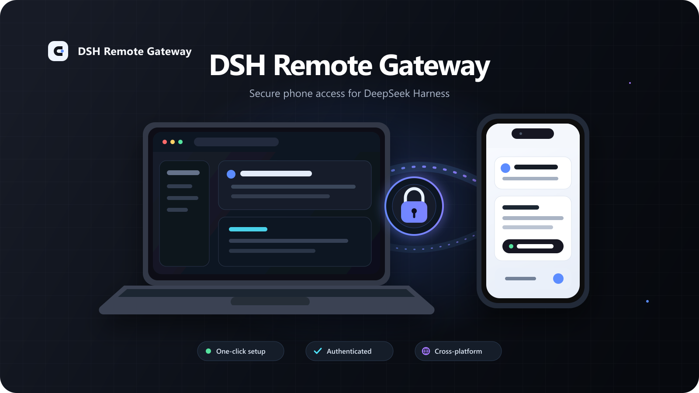
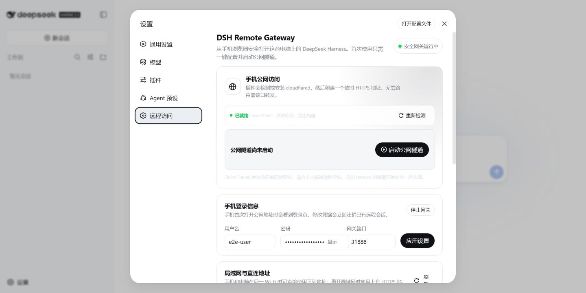
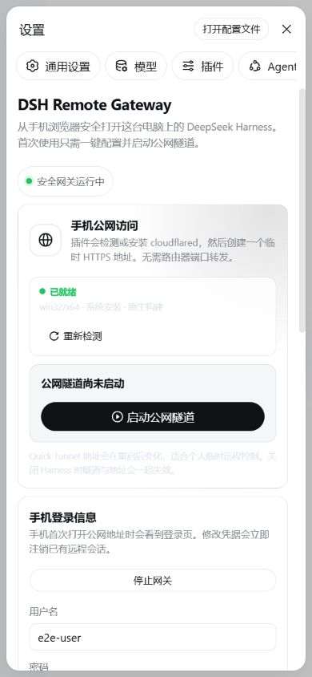
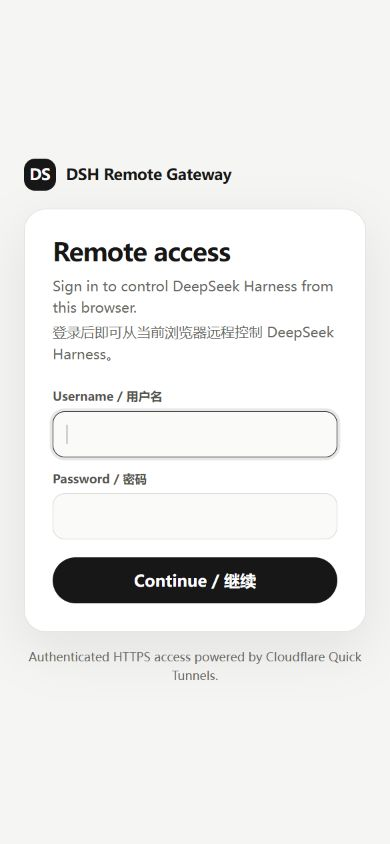

<div align="center">

# DSH Remote Gateway

**One-click, authenticated phone access to DeepSeek Harness.**

[简体中文](README.zh-CN.md) · [CLI installation](docs/cli-install.md) · [AI-assisted installation](docs/ai-install.md) · [Security](SECURITY.md)

<br>



</div>

DSH Remote Gateway adds a polished **Remote Access** page to DeepSeek Harness settings. It can detect or securely install `cloudflared`, create a temporary HTTPS address, and protect Harness with a dedicated login before proxying HTTP and WebSocket traffic.

> [!WARNING]
> DeepSeek Harness can run shell commands and access files. Treat remote access like remote control of your computer: use a unique password, keep the Harness Web server bound to `127.0.0.1`, do not share the tunnel URL, and stop the tunnel when it is not needed.

## Preview

### Remote Access settings



### Mobile experience

<table>
<tr>
<td width="50%" align="center"></td>
<td width="50%" align="center"></td>
</tr>
<tr>
<td align="center">Responsive settings</td>
<td align="center">Authenticated login page</td>
</tr>
</table>

The screenshots use an isolated test profile with synthetic credentials. No personal account, filesystem path, or Harness session data is included.

## Highlights

- One-click setup and tunnel start from Harness settings
- Responsive English and Simplified Chinese interface
- Authenticated HTTP and WebSocket reverse proxy
- Secure cookies, login throttling, and temporary source-address bans
- Automatic `cloudflared` discovery or managed installation
- Pinned Cloudflare release with size and SHA-256 verification
- Windows x64/ARM64, Linux x64/ARM64, and macOS x64/ARM64 support
- Automatic replacement of a registered tunnel whose public login page is not reachable
- Clean tunnel and process-tree shutdown with Harness

## How it works

```text
Phone browser
    │ HTTPS
    ▼
Cloudflare Quick Tunnel
    │ HTTP on loopback
    ▼
DSH Remote Gateway :3088
    │ authenticated HTTP + WebSocket proxy
    ▼
DeepSeek Harness Web on 127.0.0.1
```

The public address changes whenever the Quick Tunnel is recreated. No router port forwarding, Cloudflare account, or custom domain is required.

## Requirements

- DeepSeek Harness with profile bundles and `dsh plugin` support
- Harness Web server service `@deepseek-ai/dsh-host-webserver >= 0.0.1-rc.1` or the compatible legacy `httpServer` service
- Node.js `^22.19.0` or `>=24.0.0`
- pnpm available to the `dsh plugin` command
- Windows installations need the system `curl.exe` included with supported modern Windows releases for the public reachability check

This project currently targets prerelease DeepSeek Harness APIs. Check the release notes before upgrading either project.

## Install

```powershell
dsh plugin --profile web add github:Yari-tuber/dsh-remote-gateway
```

Git dependencies run this package's `prepare` build. pnpm 10 and newer block dependency build scripts until explicitly allowed. If the first command reports `allowBuilds`, add this entry to the profile file printed by Harness, normally `~/.dsh/profiles/web/pnpm-workspace.yaml`:

```yaml
allowBuilds:
  dsh-remote-gateway: true
```

Run the install command again, then start Harness:

```powershell
dsh --profile web
```

Open **Settings → Remote Access**, choose a unique username and password, then select **Set up and start**. See the [complete CLI guide](docs/cli-install.md) for local checkout installation, removal, and troubleshooting.

## AI-assisted installation

Give your coding agent the audited prompt in [AI-assisted installation](docs/ai-install.md). It instructs the agent to install only this bundle, preserve existing Harness settings, avoid printing credentials, and verify the plugin without exposing Harness directly to the network.

## Configuration reference

The bundle provides safe defaults in [`cordis.patch.yml`](cordis.patch.yml). A profile patch can replace the complete `dsh-remote-gateway` config when deployment-specific values must persist.

| Field | Default | Purpose |
|---|---:|---|
| `enabled` | `true` | Start the authenticated gateway with Harness. |
| `listenHost` | `::` | Accept LAN IPv4/IPv6 where dual stack is available. |
| `port` | `3088` | Authenticated gateway port. |
| `username` | `admin` | Initial login username. |
| `password` | empty | Generate a strong in-memory password at boot. |
| `maxFailedAttempts` | `5` | Failed logins before a temporary ban. |
| `banDurationMinutes` | `15` | Temporary ban duration. |
| `cloudflaredPath` | `cloudflared` | Executable name or absolute path. |
| `autoInstallCloudflared` | `true` | Install the verified pinned build when missing. |
| `autoStartQuickTunnel` | `false` | Start a public tunnel during Harness startup. |
| `tunnelProtocol` | `http2` | Cloudflare connector transport: `auto`, `http2`, or `quic`. |
| `tunnelStartupTimeoutMs` | `30000` | Registration timeout for one allocation. |
| `tunnelStartupAttempts` | `3` | Allocations attempted before failing. |
| `tunnelReachabilityTimeoutMs` | `10000` | Public login-page probe timeout. |
| `processGraceMs` | `5000` | Process-tree shutdown grace period. |
| `webServerStartupTimeoutMs` | `30000` | Harness Web service discovery timeout. |

Runtime username, password, port, and enabled-state edits take effect immediately. Set persistent deployment values in the profile patch; an empty password intentionally generates a new password after restart.

## Managed `cloudflared`

When no configured or system executable is available, the plugin downloads an official Cloudflare release into `$DSH_HOME/tools/dsh-remote-gateway`. The asset version, byte length, and SHA-256 digest are pinned in source. Installation uses private temporary storage and atomically replaces the executable and install manifest.

Windows ARM64 uses Cloudflare's x64 executable through Windows emulation because Cloudflare does not publish a Windows ARM64 Quick Tunnel asset for the pinned release.

Cloudflare may temporarily rate-limit repeated Quick Tunnel creation. The plugin stops after the first explicit HTTP 429/error 1015 or non-JSON allocation rejection; wait before trying again instead of repeatedly clicking start.

## Security and privacy

- Keep the main Harness Web server on loopback. Binding it to a LAN or public interface can bypass this gateway.
- Authentication state, failed-login counters, and generated credentials are memory-only.
- The plugin has no telemetry. Managed installation contacts GitHub Releases; Quick Tunnel operation contacts Cloudflare.
- Quick Tunnels have no uptime guarantee and are intended for personal, temporary access rather than production or multi-user deployments.

Read [SECURITY.md](SECURITY.md) and [PRIVACY.md](PRIVACY.md) before enabling remote access.

## Development

```powershell
pnpm install
pnpm run typecheck
pnpm run test
pnpm run prepare
```

See [CONTRIBUTING.md](CONTRIBUTING.md) for contribution and verification requirements.

## License

MIT. This community project is not an official DeepSeek or Cloudflare product. Product names and trademarks belong to their respective owners.
