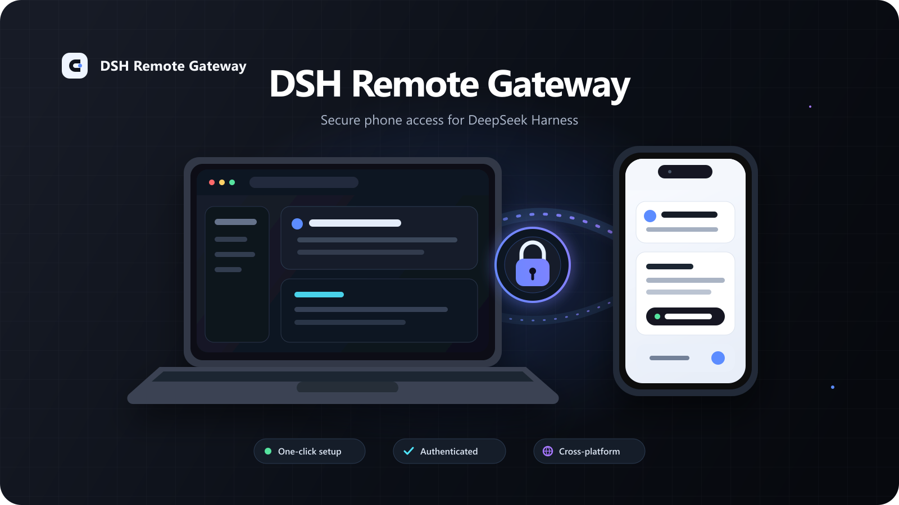
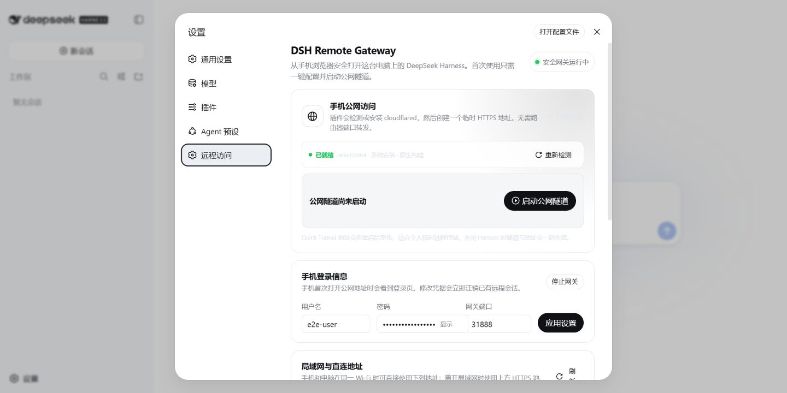
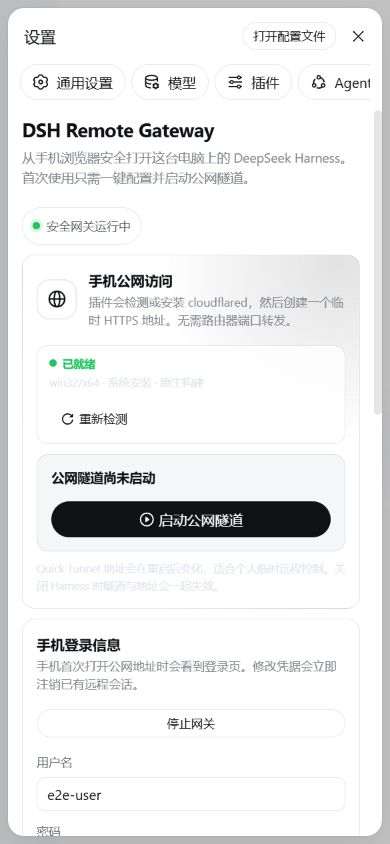
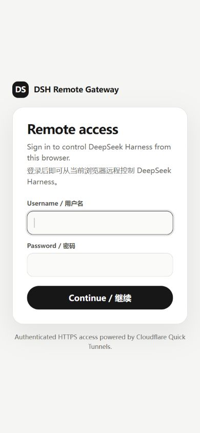

<div align="center">

# DSH Remote Gateway

**一键、安全地从手机浏览器访问 DeepSeek Harness。**

[English](README.md) · [命令行安装](docs/cli-install.zh-CN.md) · [AI 辅助安装](docs/ai-install.zh-CN.md) · [安全策略](SECURITY.md)

<br>



</div>

DSH Remote Gateway 会在 DeepSeek Harness 设置中加入美观的**远程访问**页面。它可以检测或安全安装 `cloudflared`、创建临时 HTTPS 地址，并在转发 Harness 的 HTTP 与 WebSocket 流量前要求独立登录。

> [!WARNING]
> DeepSeek Harness 能执行命令并访问文件。请把远程访问视为对电脑的远程控制：使用独立强密码、让 Harness 主 Web 服务只监听 `127.0.0.1`、不要分享隧道地址，并在不用时停止隧道。

## 界面预览

### 远程访问设置



### 手机端体验

<table>
<tr>
<td width="50%" align="center"></td>
<td width="50%" align="center"></td>
</tr>
<tr>
<td align="center">响应式设置页面</td>
<td align="center">独立认证登录页</td>
</tr>
</table>

截图来自使用测试凭据的隔离 profile，不包含个人账号、本机目录或 Harness 会话数据。

## 主要功能

- 在 Harness 设置中一键配置并启动隧道
- 响应式中英文界面，适配手机
- 带登录保护的 HTTP 与 WebSocket 反向代理
- 安全 Cookie、登录限速与来源地址临时封禁
- 自动检测或托管安装 `cloudflared`
- 固定 Cloudflare 官方版本，并校验文件大小和 SHA-256
- 支持 Windows x64/ARM64、Linux x64/ARM64、macOS x64/ARM64
- 公网登录页不可达时自动销毁并重新申请隧道
- Harness 关闭时清理隧道和完整进程树

## 工作方式

```text
手机浏览器
    │ HTTPS
    ▼
Cloudflare Quick Tunnel
    │ 本机回环 HTTP
    ▼
DSH Remote Gateway :3088
    │ 已认证的 HTTP + WebSocket 代理
    ▼
127.0.0.1 上的 DeepSeek Harness Web
```

每次重新创建 Quick Tunnel 后公网地址都会变化。无需配置路由器端口转发、Cloudflare 账号或自定义域名。

## 环境要求

- 支持 profile bundle 和 `dsh plugin` 的 DeepSeek Harness
- `@deepseek-ai/dsh-host-webserver >= 0.0.1-rc.1`，或提供兼容旧版 `httpServer` 服务的 Harness
- Node.js `^22.19.0` 或 `>=24.0.0`
- `dsh plugin` 可以调用 pnpm
- Windows 需要受支持的现代系统自带 `curl.exe`，用于验证公网登录页

本项目当前适配 DeepSeek Harness 的预发布 API。升级任一项目之前请先查看发布说明。

## 安装

```powershell
dsh plugin --profile web add github:Yari-tuber/dsh-remote-gateway
```

Git 依赖会通过本项目的 `prepare` 脚本构建。pnpm 10 及以上版本默认禁止依赖执行构建脚本。如果首次安装提示 `allowBuilds`，请在 Harness 输出的 profile 文件中加入以下配置；通常是 `~/.dsh/profiles/web/pnpm-workspace.yaml`：

```yaml
allowBuilds:
  dsh-remote-gateway: true
```

重新执行安装命令，然后启动 Harness：

```powershell
dsh --profile web
```

打开**设置 → 远程访问**，设置独立用户名和强密码，然后点击**一键配置并启动**。本地源码安装、卸载和排错说明请查看[完整命令行指南](docs/cli-install.zh-CN.md)。

## AI 辅助安装

可以把 [AI 辅助安装](docs/ai-install.zh-CN.md)中的审计提示词交给编程智能体。提示词要求智能体只安装本 bundle、保留现有 Harness 设置、不打印凭据，并在不直接暴露 Harness 的前提下验证插件。

## 配置参考

[`cordis.patch.yml`](cordis.patch.yml) 提供安全默认值。如需让部署参数跨重启保存，请在 profile patch 中完整替换 `dsh-remote-gateway` 的 config。

| 字段 | 默认值 | 作用 |
|---|---:|---|
| `enabled` | `true` | 随 Harness 启动认证网关。 |
| `listenHost` | `::` | 在支持双栈时接受局域网 IPv4/IPv6。只使用 Quick Tunnel 时请设为 `127.0.0.1`。 |
| `port` | `3088` | 认证网关端口。 |
| `username` | `admin` | 初始登录用户名。 |
| `password` | 空 | 启动时生成高强度内存密码。少于 10 个字符的值会被自动生成的密码替代。 |
| `maxFailedAttempts` | `5` | 同一来源地址在一个封禁时长内触发临时封禁前允许的失败次数。 |
| `banDurationMinutes` | `15` | 临时封禁时长。 |
| `cloudflaredPath` | `cloudflared` | 可执行文件名或绝对路径。 |
| `autoInstallCloudflared` | `true` | 缺失时安装已校验的固定版本。 |
| `autoStartQuickTunnel` | `false` | Harness 启动时自动创建公网隧道。 |
| `tunnelProtocol` | `http2` | Cloudflare 连接协议：`auto`、`http2` 或 `quic`。 |
| `tunnelStartupTimeoutMs` | `30000` | 单次申请的注册超时。 |
| `tunnelStartupAttempts` | `3` | 失败前最多申请次数。 |
| `tunnelReachabilityTimeoutMs` | `10000` | 公网登录页探测超时。 |
| `processGraceMs` | `5000` | 关闭进程树的宽限时间。 |
| `webServerStartupTimeoutMs` | `30000` | Harness Web 服务发现超时。 |

界面中的用户名、密码、端口和启用状态会立即生效。持久部署值需要写入 profile patch；密码留空时，重启后会有意生成新密码。

## 托管 `cloudflared`

找不到自定义或系统可执行文件时，插件会把 Cloudflare 官方版本下载到 `$DSH_HOME/tools/dsh-remote-gateway`。源码固定了版本、字节数和 SHA-256 摘要。安装过程使用私有临时目录，并原子替换可执行文件和安装清单。

Cloudflare 没有为固定版本提供 Windows ARM64 Quick Tunnel 文件，因此 Windows ARM64 会通过系统仿真运行 x64 版本。

反复创建 Quick Tunnel 时，Cloudflare 可能会临时限流。遇到明确的 HTTP 429/error 1015 或非 JSON 分配拒绝后，插件会在第一次失败时停止；请等待一段时间再试，不要连续点击启动。

## 安全与隐私

- Harness 主 Web 服务必须只监听回环地址；监听局域网或公网网卡可能绕过本插件。
- 登录会话、失败计数和自动生成的凭据只保存在内存中。
- 登录会话 12 小时后过期，退出登录或修改用户名/密码后立即失效。最多保留 32 个会话，超出时最早的会话先失效。
- 登录失败按来源地址计数。Quick Tunnel 访客通过本机 `cloudflared` 转发的 `CF-Connecting-IP` 请求头识别，陌生人猜错密码不会把你锁在外面；局域网直连时会忽略该请求头。
- 局域网直连地址使用明文 HTTP，密码会以未加密形式经过局域网。只使用 Quick Tunnel 时请把 `listenHost` 设为 `127.0.0.1`，不要在不可信网络或公网 IPv6 地址上暴露网关端口。
- 插件不包含遥测。托管安装会访问 GitHub Releases，Quick Tunnel 会连接 Cloudflare。
- Quick Tunnel 不保证可用性，适合个人临时访问，不适合作为生产或多人入口。

启用远程访问前请阅读 [SECURITY.md](SECURITY.md) 和 [PRIVACY.md](PRIVACY.md)。

## 开发

```powershell
pnpm install
pnpm run typecheck
pnpm run test
pnpm run prepare
```

贡献与验证要求请查看 [CONTRIBUTING.md](CONTRIBUTING.md)。

## 许可证

MIT。本项目是社区项目，不是 DeepSeek 或 Cloudflare 的官方产品；产品名和商标归各自所有者。
